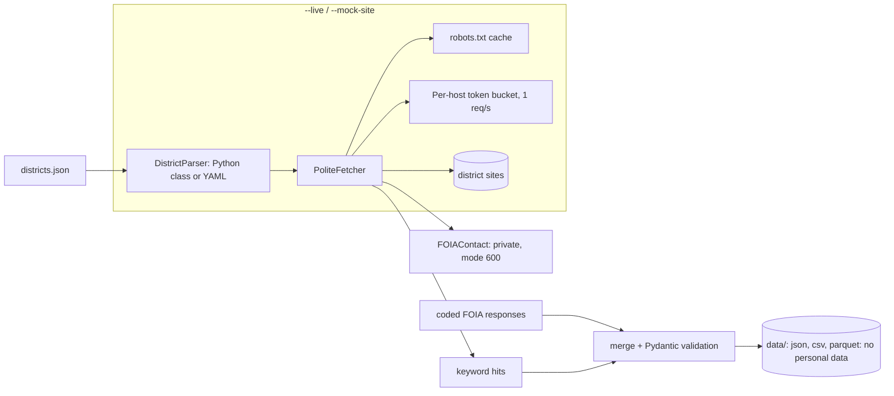

# cents-pipeline

Polite public-records discovery and K-8 financial literacy audit pipeline used by [CENTS](https://centscampaign.org).

It does two separate jobs:
1. **Discovery (optional, `--live`):** crawl district websites to find public officials' contact pages and scan curriculum pages for financial-literacy keywords. Contacts are **private** output.
2. **Audit dataset:** merge coded FOIA email responses into a validated, **PII-free** public dataset (`data/nc_audit.{json,csv,parquet}`).

The published counts (23 districts confirmed with no dedicated K-8 course, 1 implementing, 91 unresolved, of 115) come from **coded FOIA replies**, not from the crawler. Keyword hits from crawling are supplementary evidence only.



## Install and run
```bash
python -m venv .venv && . .venv/bin/activate
pip install -e ".[dev]"
pytest

cents audit --state NC --coded data/source/nc_coded_responses.json --output json        # offline, JSON to stdout
cents audit --state NC --output csv --out-dir out                                          # write a file
cents audit --state NC --live --parser parsers/generic_directory.yaml \
    --contacts-out private/contacts.json                                                   # real crawl (be polite)
cents export --coded data/source/nc_coded_responses.json --out-dir data                   # build public datasets
cents validate data/nc_audit.json
```
No network is used unless `--live` is passed. `--rate` cannot exceed 1.

## Web compliance
- Every request, including `robots.txt` and retries, goes through an async per-host token bucket (**1 request/second/host**; `Crawl-delay` in robots.txt slows a host further).
- `robots.txt` is honoured: missing file allows, 401/403/5xx/network error blocks.
- Custom `User-Agent` (override with `CENTS_USER_AGENT`); `Retry-After` honoured on 429/503, capped at 30s.
- Different hosts crawl concurrently; one host is never hit in parallel.

## Adding a district parser
In Python:
```python
from cents.parsers import DistrictParser, register

@register
class MyVendor(DistrictParser):
    name = "my-vendor"
    def contact_urls(self, district): ...
    def parse_contacts(self, district, url, html): ...
```
Or in YAML (see `parsers/generic_directory.yaml`, 12 lines) and pass its path to `--parser`.

## Data and privacy
- `FOIAContact` (names, emails) is written only via `--contacts-out` to a git-ignored `private/` path with mode 600.
- `CurriculumAuditResult` is the only public model. It rejects emails and phone numbers in free text, and `cents validate`, `cents export` and CI refuse any `@` in public rows.
- `data/source/` is generated from the CENTS tracker by `scripts/import_tracker_snapshot.py`; respondent names and reply text are dropped.
- Reports describe what districts stated. They do not assess legal compliance.

## CI
`.github/workflows/data-pipeline.yml` runs weekly (and on PRs): tests, an offline smoke audit of fixture districts, schema validation, export to Parquet/CSV/JSON, a PII check, then commits refreshed `data/nc_audit.*`.

## Not built
Redis/Celery workers: see [docs/DISTRIBUTED.md](docs/DISTRIBUTED.md) for the design.

## License
MIT
